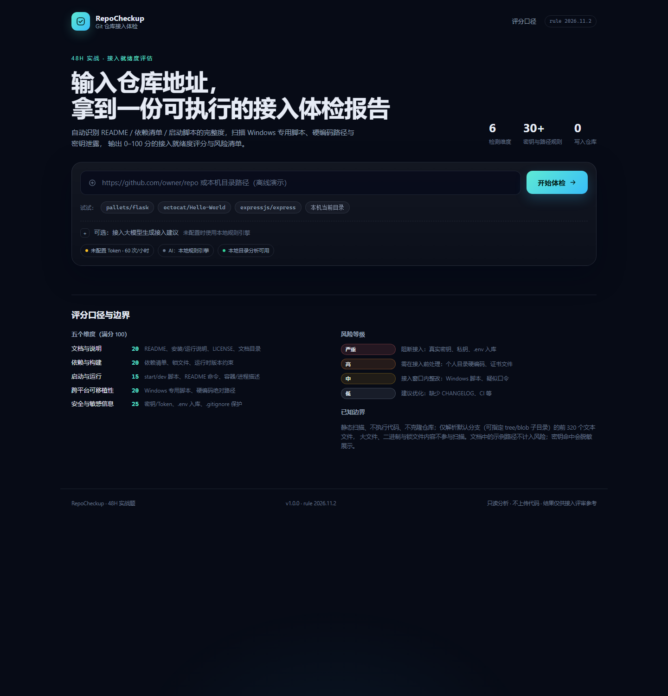
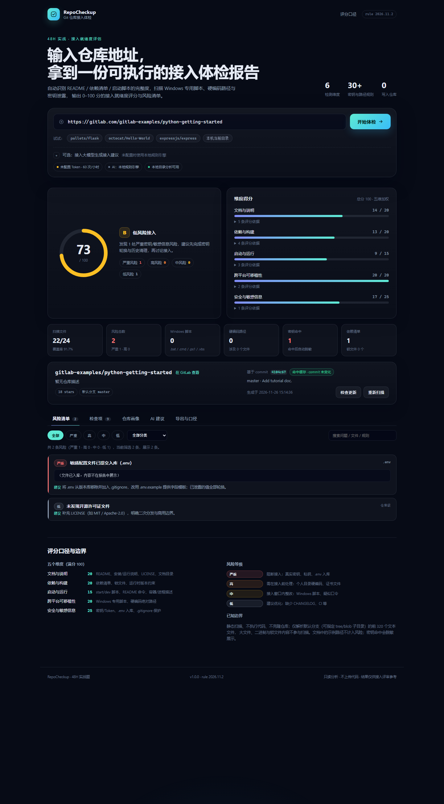

# RepoCheckup · Git 仓库接入体检

输入一个公开 Git 仓库地址（GitHub / GitLab，也支持本机目录），自动产出一份「接入体检报告」：
文档完整度、依赖清单、启动方式、Windows 专用脚本、硬编码绝对路径、密钥与敏感信息风险，
并给出**接入就绪度评分**、**主要风险清单**和**整改建议**。

- 纯 Python 标准库实现，零第三方依赖，`python server.py` 即可运行
- 前端原生 HTML/CSS/JS，无 CDN，离线可用
- 不做本地克隆，只读 API + CDN 原始文件，几十秒扫完一个中型仓库

## 快速开始

### 安装

无需安装第三方依赖：Python 3.10+ 标准库即可运行，直接执行下面的命令。

```bash
# 1) 启动 Web 服务（默认 http://127.0.0.1:8000）
python server.py

# 2) 可选：配置 GitHub Token 提升 API 配额（未配置为 60 次/小时）
set GITHUB_TOKEN=ghp_xxx        # Windows CMD
$env:GITHUB_TOKEN="ghp_xxx"     # PowerShell

# 3) 命令行模式（便于接入 CI）
python server.py --analyze https://github.com/pallets/flask --out report.md --json report.json

# 4) 离线自测（10 项，不联网）
python -m unittest discover -s tests -v
```

需要 Python 3.10+（使用了 `str | None` 类型标注）。

## 界面截图

首页：



体检报告（`https://gitlab.com/gitlab-examples/python-getting-started`，commit `aab78e2`）：



也可以直接用 `?url=` 参数直达某份报告，便于分享链接或在 CI 里截图：
`http://127.0.0.1:8000/?url=https://github.com/pallets/flask`。
命令行产出的完整 Markdown 样例见 [docs/sample-report-flask.md](docs/sample-report-flask.md)。

## 页面能做什么

- 输入仓库地址（或用示例快捷按钮），一键分析，进度条展示「解析地址 → 拉取文件树 → 读取文件 → 规则检测 → 评分」
- 评分环 + 等级（A/B/C/D）+ 一句话结论
- 五个维度分数与逐条扣分理由（可解释，不是黑盒）
- 风险清单：按严重程度筛选、按关键字搜索、按分类过滤，每条带文件位置、代码行、整改建议和 GitHub 跳转链接
- 检查项清单（通过 / 警告 / 不通过）、仓库画像（语言、Star、许可证、CI、测试目录等）
- 一键「检查更新」：比较上游最新 commit 与当前报告的 commit
- 导出 Markdown / JSON、打印为 PDF
- 可选 AI 建议：填写任意 OpenAI 兼容接口（base_url / model / api_key）即启用；未配置或调用失败自动回退到内置规则建议

## 检测范围

| 分类 | 检测内容 |
| --- | --- |
| 文档 | README 是否存在、是否包含安装与运行说明、标题与代码块结构、LICENSE、CHANGELOG/CONTRIBUTING、docs 目录 |
| 依赖 | package.json / requirements.txt / pyproject.toml / go.mod / Cargo.toml / pom.xml / build.gradle / composer.json / Gemfile、lock 文件、运行时版本约束（.nvmrc、engines、requires-python 等）、package.json 是否可解析 |
| 启动 | package.json 的 start/dev/serve 脚本、Makefile 的 run/dev/start/serve 目标、Procfile、Dockerfile / compose、README 中可复制的运行命令 |
| Windows 专用 | `.bat` / `.cmd` / `.ps1` / `.vbs` 脚本；`%APPDATA%` / `%USERPROFILE%`、行首 `setx` / `chcp`、PowerShell `-ExecutionPolicy`、`win32api` / `winreg` 等导入、`C:\Windows\System32` |
| 硬编码路径 | `C:\Users\...`、任意盘符绝对路径、`/Users/...`、`/home/...`、UNC 共享、`file:///`、`/opt` `/var/www` `/srv` `/data` `/mnt` 等常见绝对路径 |
| 密钥与敏感信息 | 私钥内容、OpenAI/Anthropic `sk-`、Stripe live、AWS Access Key、GitHub Token、阿里云 AccessKey、腾讯云 SecretId、Google API Key、Slack Token、Bearer、JWT、通用口令/key 赋值、`.env` 入库、`*.pem`/`*.key`/`id_rsa` 等文件入库 |

误报控制（均为实测踩坑后补的规则）：

- 文档（`.md` / `.rst` / `docs/`）里的示例路径与示例密钥不算硬编码/泄露，只做低级别提示
- 跳过 `re.compile(...)` 定义行，避免工具把自身规则当成风险
- 占位符（`your_xxx`、`xxxx`、`<...>`、`...`、`env[...]`、`config.`、`settings.`）不报警
- 赋值右侧是表达式（`request.form[...]`、`self.xxx`、`config.get(...)`）时不算硬编码凭据
- `WHERE`、`copy` 等普通单词不再被当成 Windows 命令；`make getting started` 这类散文不再被当成启动命令
- `tests/` `fixtures/` `examples/` 下的 `.env` 降级为「高」而不是「严重」
- 报告中的密钥统一脱敏为 `前4位…后3位`

## 评分口径（总分 100）

| 维度 | 满分 | 得分要点 | 扣分要点 |
| --- | --- | --- | --- |
| 文档与说明 | 20 | README 存在 9，安装说明 2，运行说明 2，结构完整 1，LICENSE 3，CHANGELOG/CONTRIBUTING 1.5，docs 目录 1.5 | 缺失项不得分 |
| 依赖与构建 | 20 | 依赖清单 10，lock 文件 4，运行时版本约束 3，清单可解析 3 | 缺少 lock / 版本约束按项扣除 |
| 启动与运行 | 15 | start/dev 脚本 6，README 运行命令 4，容器/Procfile/启动型 Makefile 目标 5 | 未发现启动方式额外产生中风险 |
| 跨平台可移植性 | 20 | 基准 20 | Windows 脚本每个 -1.5（上限 6）、硬编码路径每文件 -1.5（上限 9）、个人目录/盘符每处 -1.2（上限 5） |
| 安全与敏感信息 | 25 | 基准 25 | 严重每个 -8（上限 20）、高危每个 -4（上限 10）、中危每个 -1.5（上限 6）、.gitignore 未覆盖 .env -2~-3 |

等级：A ≥ 85 且无严重风险（可直接接入）／B ≥ 70（低风险接入）／C ≥ 55（需整改后接入）／D < 55（高风险，暂缓接入）。
存在严重风险时，无论总分多少都会在结论里标记为接入阻断项。

## 架构

```
server.py            HTTP 服务（标准库 ThreadingHTTPServer）+ CLI
analyzer/
  provider.py        地址解析、GitHub/GitLab API、CDN 原文抓取、blob 缓存、本地目录模式
  rules.py           全部检测规则（文档/依赖/启动/Windows/路径/密钥/规范）
  scoring.py         五维评分与等级
  render.py          Markdown 报告
  ai.py              规则建议引擎 + 可选 LLM（OpenAI 兼容）
  core.py            编排、报告缓存、更新检查、失败兜底
web/                 单页前端（index.html / styles.css / app.js）
tests/               离线单元测试
```

数据流：`parse_target → resolve_head（1 次 API）→ git/trees?recursive=1（1 次 API）→ 按优先级抓文本 → rules → scoring → ai → report`。
GitHub 文件正文优先走 jsDelivr 镜像（fastly / gcore），失败再回退 `raw.githubusercontent.com`，避免 raw 域名超时拖垮整次分析；
GitLab 走 API 的 raw 接口（`/repository/files/{path}/raw?ref={sha}`），失败再回退 `/-/raw/{sha}/path`
（部分网络环境下 gitlab.com 的 `/-/raw/` 会被 Cloudflare 挑战拦截，返回 403）。单次分析有总时间预算，超预算的文件跳过并写入 `warnings`，覆盖率在报告里可见。

## HTTP API

| 方法 | 路径 | 说明 |
| --- | --- | --- |
| GET | `/api/health` | 服务状态、规则版本、是否配置 GitHub Token / LLM |
| GET | `/api/head?url=` | 上游最新 commit、是否与本地报告不同 |
| POST | `/api/analyze` | `{"url": "...", "force": false, "ai": {"base_url","model","api_key"}}` → 完整报告 JSON |

错误统一为 `{"error": {"code","message","detail"}}`；限流返回 429 并带 `reset_at`。
`url` 支持 `https://github.com/owner/repo`、带 `/tree/<ref>/<subdir>` 的深链接、GitLab、以及本机目录（服务端可用 `--no-local` 关闭）。

## 更新跟踪设计

题目要求说明「原仓库更新后如何发现并更新报告」，这里给出设计，且其中的缓存与兜底机制已实际实现。

### 1. 怎么发现更新

- 报告里固定写入 `commit.sha`（完整 sha）、`short_sha`、`ref`、`date`、`message`、`url`。
- 前端「检查更新」调用 `GET /api/head?url=`，服务端只做 1 次 `/repos/{o}/{r}/commits/{branch}` 请求拿到最新 sha，
  与最近一份报告的 `commit.sha` 比较，返回 `changed: true/false`。
- 页面提示「上游有新提交 abcd123（3 天前），当前报告基于 49943b5」，用户点「重新体检」才重算，避免每次打开页面都触发分析。
- 进一步可接 GitHub Webhook（push 事件）或定时轮询 `pushed_at`，把「按需触发」升级为「自动触发增量体检」。

### 2. 怎么避免全量重算

- **报告级缓存**：报告文件名为 `{host}_{owner_repo}_{subdir}_{commit_sha}_{rule_version}.json`。
  同一 commit 重复请求直接命中缓存（报告里标注 `cache.report_hit = true`），不再调 API、不再抓文件。
- **文件级内容寻址缓存**：每个文件文本按 git blob sha 存到 `.cache/blobs/{sha[:2]}/{sha}.txt`。
  新 commit 到来时，只有 blob sha 变化的文件需要重新下载，其余直接命中本地缓存（报告里 `cache.blob_hits / blob_misses` 可观测）。
  典型提交只改几个文件，因此二次分析的主要耗时从「下载全部文件」降为「1 次 API + 少数文件」。
- **规则版本隔离**：缓存键包含 `rule_version`，规则升级后旧报告自动失效、不会拿旧规则结果冒充新结果。
- **扫描优先级**：文件树按「README / 依赖清单 / 配置文件 / 源码 / 其它」排序，超出时间预算时优先保证高价值文件被读到。

### 3. 报告如何标注所基于的 commit

- 报告页顶部显示 `commit 短 sha + 提交时间 + 提交信息`，可点击跳到 GitHub commit 页面。
- 导出 Markdown 的报告头同样包含 `commit: 49943b5` 与规则版本。
- JSON 中 `commit` 与 `tool.rule_version` 字段即为溯源依据；`cache.stale = true` 表示该报告来自历史缓存、并非对应当前 HEAD。

### 4. 失败或限流时怎么兜底

- 上游 API 限流（403/429）→ 抛出 `RateLimitError`，服务端返回 429 并附 `reset_at`；
  若本地存在该仓库的历史报告，则回退到最近一次成功报告，附警告「上游暂时不可用（rate_limited），本报告基于 commit xxx，可能已过期」。
- 网络错误 / 超时 / 上游 5xx → 同样回退到最近成功报告并标记 `stale`。
- 完全没有历史报告时，返回明确错误信息（含配额重置时间），不返回空报告。
- 文件级失败不影响整体：单个文件抓取失败只写入 `warnings` 并计入覆盖率缺口，不会让整次分析失败。

## 已知局限

- 只做静态扫描，不执行代码、不装依赖，因此「启动方式是否真能跑起来」只能靠清单与文档推断。
- 不扫 git 历史，只扫当前 commit 快照；历史泄露需要用 gitleaks / trufflehog 等专用工具配合。
- 密钥检测以正则为主，通用口令规则会有少量误报（已降级为「中」并脱敏展示），需要人工复核。
- GitHub 未配置 Token 时 API 配额为 60 次/小时，频繁分析会被限流（此时走 stale 兜底）。
- 大仓库（>300 个可读文件）会按优先级截断，覆盖率会在报告中明示。

## AI 使用说明

见 [AI_USAGE.md](AI_USAGE.md)：使用了哪些 AI 工具、关键提示词、如何验证 AI 输出，以及「AI 答错但被我发现」的记录。
